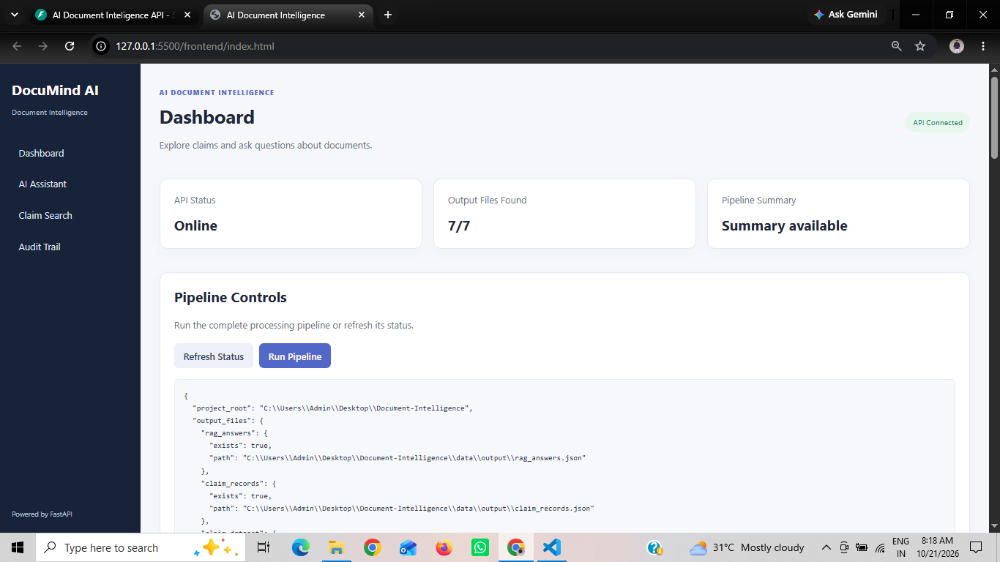
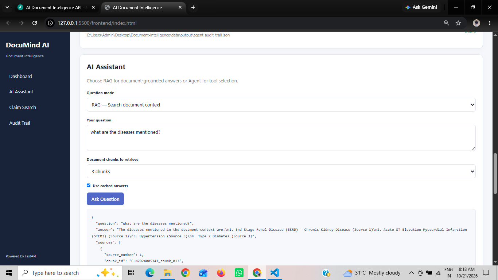
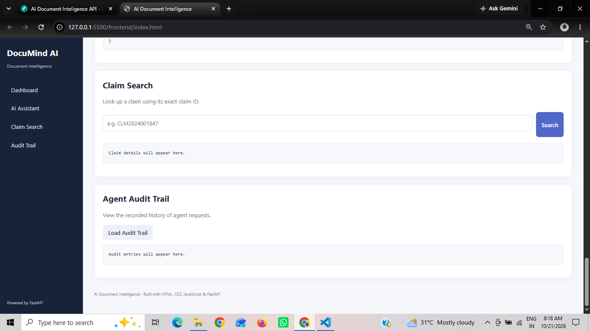

# DocuMind AI
### AI-Powered Document Intelligence for Insurance Claims

DocuMind AI is an AI-powered document intelligence platform that processes insurance claim documents, answers questions using Retrieval-Augmented Generation (RAG), uses LLM agents to select appropriate tools, and transforms extracted information into structured, ML-ready datasets.

The project combines document processing, semantic search, large language models, structured data extraction, and data quality validation in one application.

## Key Features

- **PDF Processing:** Extract and preprocess text from insurance claim documents.
- **RAG-Based Question Answering:** Retrieve relevant document chunks and generate grounded answers with source references.
- **LLM-Based Agent:** Select appropriate tools to answer document and structured-data questions.
- **Vector Search:** Store and retrieve document embeddings using ChromaDB.
- **Structured Claim Extraction:** Extract claim information into a validated schema using Pydantic.
- **Data Quality Validation:** Check required fields, missing values, claim amounts, and duplicate claim IDs.
- **ML-Ready Dataset:** Export structured claim records to CSV.
- **FastAPI Backend:** Expose the existing Python functionality through API endpoints.
- **Interactive Web Interface:** Explore pipeline status, ask questions, search claims, and view agent audit history.

## Screenshots

### Dashboard


### AI Assistant


### Claim Search


### Agent Audit Trail


> Replace the screenshot filenames above with the exact filenames you saved in the `screenshots/` folder.

## Architecture

```text
Insurance Claim PDFs
        |
        v
PDF Text Extraction & Preprocessing
        |
        v
Text Chunking & Validation
        |
        v
Embeddings & ChromaDB Vector Store
        |
        v
RAG Question Answering

Claim Documents
        |
        v
Structured Claim Extraction
        |
        v
Pydantic Validation & Data Quality Checks
        |
        v
CSV Dataset & Data Dictionary

React-free Web Frontend (HTML, CSS, JavaScript)
        |
        v
FastAPI Endpoints
        |
        v
RAG Pipeline / LLM Agent / Claim Data Tools
```

## Tech Stack

| Category | Technologies |
|---|---|
| Language | Python |
| Backend API | FastAPI |
| Data Validation | Pydantic |
| Data Processing | Pandas |
| LLM Integration | LangChain, OpenAI API |
| Embeddings | OpenAI Embeddings |
| Vector Database | ChromaDB |
| Document Processing | PyMuPDF |
| Frontend | HTML, CSS, JavaScript |
| Data Formats | JSON, CSV |

## Project Structure

```text
DocuMind-AI/
├── frontend/
│   ├── index.html
│   ├── style.css
│   └── script.js
├── src/
│   ├── agents/
│   ├── api/
│   ├── config/
│   ├── extraction/
│   ├── ingestion/
│   ├── preprocessing/
│   ├── rag/
│   └── validation/
├── data/
├── main.py
├── requirements.txt
├── pyproject.toml
├── .gitignore
└── README.md
```

## Getting Started

### Prerequisites

- Python 3.10 or a compatible version for the project's dependencies
- Git
- An OpenAI API key if using the OpenAI-powered embedding, RAG, and agent functionality

### 1. Clone the repository

```bash
git clone https://github.com/MahafuzK/DocuMind-AI.git
cd DocuMind-AI
```

### 2. Create a virtual environment

```bash
python -m venv .venv
```

Activate it on Windows:

```bash
.venv\Scripts\activate
```

### 3. Install dependencies

```bash
pip install -r requirements.txt
```

### 4. Configure environment variables

Create a `.env` file in the project root and configure the variables expected by the project settings module.

For example:

```env
OPENAI_API_KEY=your_api_key_here
```

Use the exact variable names required by your implementation. Never commit your actual API key or other secrets.

### 5. Start the API

Run the following command from the project root:

```bash
python -m uvicorn src.api.app:app --host 127.0.0.1 --port 8001 --reload
```

Open the API documentation:

[http://127.0.0.1:8001/docs](http://127.0.0.1:8001/docs)

### 6. Launch the frontend

Open `frontend/index.html` using the VS Code Live Server extension.

Make sure the API base URL in `frontend/script.js` matches the port used by the backend.

## Example Questions

- What is the total claim amount for a particular claim?
- What information is available in the discharge summary?
- Show claims with a particular status.
- Retrieve a claim using its claim ID.

The answers depend on the available documents and structured claim dataset.

## Security and Data Privacy

- Never commit API keys or `.env` files.
- Do not upload real insurance claim documents, patient information, or confidential datasets.
- Use synthetic or explicitly shareable sample data when demonstrating the project publicly.

## Future Improvements

- Display AI answers and source citations in dedicated UI components.
- Add pagination, filtering, and sorting to the claims dashboard.
- Improve document retrieval and evaluation.
- Add authentication and role-based access control.
- Deploy the frontend and API.

## Author

**Mahafuz Khot**

GitHub: [@MahafuzK](https://github.com/MahafuzK)

---

*DocuMind AI — Turning documents into actionable intelligence.*
